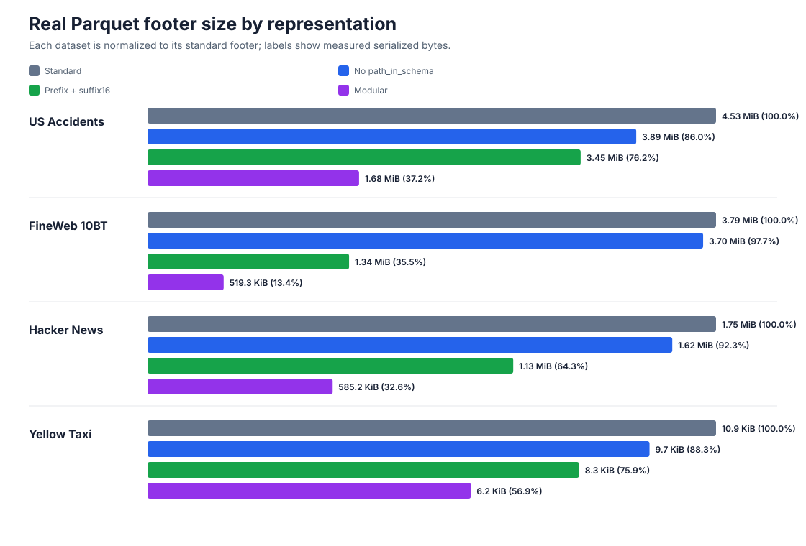
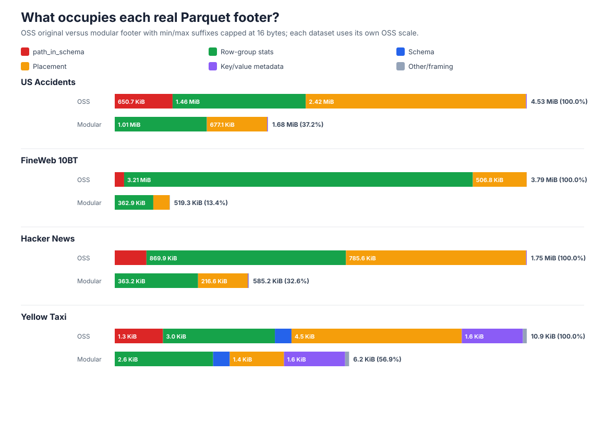

# Real Parquet footer-size benchmark

This benchmark compares footer representations using four unmodified Parquet files curated by
[Raincloud](https://github.com/spiraldb/raincloud). Three naturally have large footers; Yellow
Taxi is the normal-footer control. URLs, object sizes, footer sizes, and SHA-256 hashes are pinned
in `corpus.json`.

The tools are deliberately separate:

```sh
# Fetch only eight bytes per object and verify the pinned remote sizes.
python3 real-footer-size/probe_remote.py

# Download all four files (~2.65 GB) and verify their complete SHA-256 hashes.
python3 real-footer-size/download.py

# Inspect exact standard footer sizes from the downloaded files.
python3 real-footer-size/footer_size.py

# Regenerate the checked-in visualization.
python3 real-footer-size/visualize.py

# Regenerate the separate stacked component visualization.
python3 real-footer-size/footer_breakdown.py
```

Build the dependency-free modular converter before running the footer measurement or either
visualization command:

```sh
cmake -S . -B build -DCMAKE_BUILD_TYPE=Release
cmake --build build -j --target modular_footer_convert
```

To produce a complete file that the experimental Hardwood reader can query, replace only the
standard footer while preserving the original header, data pages, and page-index bytes:

```sh
./build/modular_footer_convert --full-file --truncate-minmax=16 \
  real-footer-size/data/yellow-tripdata-2025-01.parquet \
  real-footer-size/data/yellow-tripdata-2025-01.modular.parquet
```

Complete modular files end in
`[modular_start: LE i64][root_offset: LE i64][MFP1]`. Both the root offset and module offsets are
relative to `modular_start`. Without `--full-file`, the converter continues to emit the existing
metadata-only `MFT1` file.





Downloads use an atomic `.part` file and land in the gitignored `real-footer-size/data/` directory.
Pass one or more dataset names to either command to operate on a subset.

`footer_size.py` owns footer inspection and comparison; the downloader contains no footer-format
logic. It reports three compact-Thrift representations:

1. The byte-for-byte standard Parquet footer.
2. The standard footer with `ColumnMetaData.path_in_schema` omitted. This is experimental because
   the field is required by the current Parquet Thrift definition.
3. Variant 2 with each column chunk's statistics represented by one common prefix for min and max,
   followed by separate min and max suffixes capped at 16 bytes. Deprecated duplicate min/max
   fields are removed, and existing exactness flags are cleared when either suffix is truncated.

The third representation uses statistics field IDs 1, 2, and 5 for the prefix, min suffix, and max
suffix respectively. It is an explicit experimental wire layout, not standard Parquet. Change the
limit with `--suffix-limit`.

Before transforming a footer, the tool decodes and re-encodes it and requires byte-for-byte
equality. Thus every standard size is fidelity-checked against the actual downloaded footer rather
than estimated.

Current results with a 16-byte suffix limit:

| dataset | standard (bytes) | no path (bytes) | prefix + suffix16 (bytes) | modular (bytes) |
|---|---:|---:|---:|---:|
| US Accidents | 4,747,144 | 4,080,829 | 3,616,584 | 1,765,233 |
| FineWeb 10BT | 3,971,883 | 3,881,669 | 1,408,067 | 531,503 |
| Hacker News | 1,840,138 | 1,698,502 | 1,183,709 | 598,845 |
| Yellow Taxi | 11,212 | 9,900 | 8,512 | 5,879 |

The comparison excludes page indexes. Standard Parquet stores its page-index blobs outside the
footer, while the modular representation embeds them in modules, so including them on only one
side would not be an apples-to-apples footer-size comparison.

## Page-first modular footer

The [design notes](../modular-footer/PageFirstModularFooter.md) split the transition into
[`PageFirstModularFooterAddendum.thrift`](../modular-footer/PageFirstModularFooterAddendum.thrift)
for PAR1 and [`PageFirstModularFooterFull.thrift`](../modular-footer/PageFirstModularFooterFull.thrift)
for PAR3. Both replace column-chunk placement with an always-read DBP region map and independently
addressed per-column page descriptors. PAR1 retains required row-group arrays, row-group
statistics, and a flattened Column Index. PAR3 has no row groups or Column Index and uses row-range
statistics.

These measurements use files produced by Raincloud commit `7357517`'s actual parquet-java 1.17.1
sidecar target. The target defaults to ZSTD, a 128 MiB encoded row-group target, 1 MiB pages, a
20,000-row page limit, dictionaries, statistics, checksums, and page indexes. Every output
self-verified against its canonical Arrow input. Offset Index covers every chunk; Column Index
covers 88 of FineWeb's 99 chunks and every chunk in the other three files.

After building Raincloud's `:parquet-java:installDist` target, regenerate the corpus with:

```sh
python3 real-footer-size/rewrite_with_raincloud_parquet_java.py \
  --writer /path/to/raincloud-export-parquet-java
```

```sh
python3 modular-footer/parquet_to_page_modular.py \
  --format addendum \
  real-footer-size/data/raincloud-parquet-java/yellow-tripdata-2025-01.parquet \
  /tmp/yellow.addendum

python3 real-footer-size/page_first_split_size.py
```

The comparison script reports five semantic tiers:

1. **Thrift footer:** literal `FileMetaData`, including page-index pointers but not their blobs;
2. **Thrift full:** the Thrift footer plus external Offset Index and Column Index blobs;
3. **modular core:** framing, file metadata, schema, and placement;
4. **modular core + stats:** core plus row-group or row-range statistics; and
5. **modular full:** all applicable page placement and page statistics.

The page-index blobs are stored outside the Thrift footer and addressed by its column-chunk
metadata. Adding their serialized lengths to the footer length measures their total metadata cost;
it does not generally assume one physically contiguous byte range. In these four parquet-java
files, all index ranges are non-overlapping and collectively form one contiguous span ending
exactly where the Thrift footer begins, so the sum also equals the physical index span.

All modular statistics use a 16-byte min/max suffix limit. Each tier is serialized independently,
so its directory, region map, root, and framing reflect only its included modules. Fixed
magic/length trailers are excluded consistently.

| Dataset | Thrift footer | Thrift full |
| --- | ---: | ---: |
| US Accidents | 14,079 B | 112,106 B |
| FineWeb | 26,693 B | 159,589 B |
| Hacker News | 6,380 B | 145,910 B |
| Yellow Taxi | 5,183 B | 116,247 B |

| Dataset | Current modular core | Core + RG stats | vs Thrift footer | Current modular full | vs Thrift full |
| --- | ---: | ---: | ---: | ---: | ---: |
| US Accidents | 8,919 B | 12,229 B | −13.1% | 82,490 B | −26.4% |
| FineWeb | 2,826 B | 6,653 B | −75.1% | 69,860 B | −56.2% |
| Hacker News | 3,317 B | 4,736 B | −25.8% | 38,058 B | −73.9% |
| Yellow Taxi | 2,942 B | 4,352 B | −16.0% | 98,573 B | −15.2% |

| Dataset | PAR1 addendum core | Core + RG stats | vs Thrift footer | PAR1 addendum full | vs Thrift full |
| --- | ---: | ---: | ---: | ---: | ---: |
| US Accidents | 26,311 B | 29,626 B | +110.4% | 70,224 B | −37.4% |
| FineWeb | 29,205 B | 33,021 B | +23.7% | 58,043 B | −63.6% |
| Hacker News | 12,632 B | 14,088 B | +120.8% | 34,185 B | −76.6% |
| Yellow Taxi | 18,391 B | 19,791 B | +281.8% | 75,225 B | −35.3% |

PAR1 core already contains page-level placement, so its comparison with the chunk-oriented Thrift
footer exposes the cost of that richer placement. PAR1 full adds flat Column Index only; page
placement has already subsumed Offset Index.

| Dataset | PAR3 core | Core + row-range stats | PAR3 full | vs Thrift full |
| --- | ---: | ---: | ---: | ---: |
| US Accidents | 26,286 B | 61,586 B | 61,586 B | −45.1% |
| FineWeb | 29,071 B | 52,466 B | 52,466 B | −67.1% |
| Hacker News | 12,561 B | 32,148 B | 32,148 B | −78.0% |
| Yellow Taxi | 18,366 B | 61,647 B | 61,647 B | −47.0% |

PAR3 core + stats and full are identical: page placement subsumes Offset Index and page-granular
row-range statistics subsume Column Index. This tier is therefore compared with Thrift full.

The machine-readable output is in `page-first-split-size.csv`. `--full-file` preserves the data
prefix and emits `PMA1` or `PMF3`; the default writes metadata only for size analysis.

## Component breakdown

`footer-components.svg` keeps the total-size graph separate and divides both representations into
`path_in_schema`, row-group statistics, schema, placement, key/value metadata, and residual
framing. Placement covers offsets, sizes, codecs, and physical types. The OSS split uses
progressive clearing: it removes every path, every `ColumnMetaData.statistics`, then
`FileMetaData.row_groups`, `FileMetaData.schema`, and `FileMetaData.key_value_metadata`. The
serialized-size difference at each step is assigned to that component, so the components add up
exactly despite compact-Thrift field-header interactions.

For modular footers, schema and placement are the corresponding modules and `path_in_schema` is
zero because the schema supplies the mapping. Statistics include both the per-column descriptors
and the row-group-statistics directory. Key/value metadata is isolated inside the file-metadata
module; created-by, the modular root directory, and framing remain in other. Page indexes are
excluded from both representations.

## Common-prefix sharing versus truncation

The last column above combines two effects. Running with an effectively unlimited suffix isolates
the common-prefix representation; comparing that result with the 16-byte result isolates the
additional effect of truncation:

| dataset | no path (bytes) | prefix, untruncated (bytes) | prefix + suffix16 (bytes) | prefix saving (bytes) | truncation saving (bytes) |
|---|---:|---:|---:|---:|---:|
| US Accidents | 4,080,829 | 3,744,296 | 3,616,584 | 336,533 | 127,712 |
| FineWeb 10BT | 3,881,669 | 3,784,175 | 1,408,067 | 97,494 | 2,376,108 |
| Hacker News | 1,698,502 | 1,563,106 | 1,183,709 | 135,396 | 379,397 |
| Yellow Taxi | 9,900 | 8,512 | 8,512 | 1,388 | 0 |

FineWeb's large reduction is therefore almost entirely truncation (96% of its statistics saving),
while US Accidents benefits mostly from the prefix representation. Hacker News is mixed but leans
toward truncation, and Yellow Taxi has no statistic longer than the 16-byte suffix limit.

There is one important accounting caveat: the standard Arrow-written files contain both legacy
`min`/`max` and modern `min_value`/`max_value` fields. The experimental representation replaces
those four bounds with one prefix and two suffixes. Consequently, "prefix saving" above includes
both common-prefix sharing and removal of the duplicate legacy bounds; it does not measure prefix
sharing in isolation.

Reproduce the two measurements with:

```sh
python3 real-footer-size/footer_size.py --suffix-limit 1000000000 --csv
python3 real-footer-size/footer_size.py --suffix-limit 16 --csv
```
